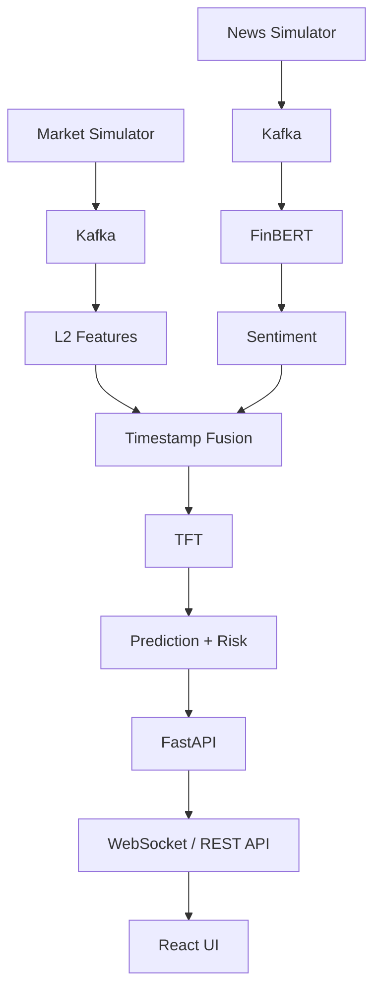

# QuantFormer: Multimodal Order Book & Sentiment Transformer

**QuantFormer** is a research-oriented prototype for exploring multimodal short-term market forecasting using order-book microstructure and financial-news sentiment.

⚠️ **DISCLAIMER**: This is a research MVP, not a production trading system. It is not intended for real trading, profit generation, or financial advice.

## Table of Contents

1. [Project Overview](#project-overview)
2. [Problem Statement](#problem-statement)
3. [Architecture](#architecture)
4. [Features](#features)
5. [Technology Stack](#technology-stack)
6. [Project Structure](#project-structure)
7. [Installation](#installation)
8. [Docker Setup](#docker-setup)
9. [Local Development](#local-development)
10. [Kafka Setup](#kafka-setup)
11. [FinBERT Setup](#finbert-setup)
12. [Dataset Generation](#dataset-generation)
13. [TFT Training](#tft-training)
14. [Running the Application](#running-the-application)
15. [API Documentation](#api-documentation)
16. [WebSocket Documentation](#websocket-documentation)
17. [Testing](#testing)
18. [Limitations](#limitations)
19. [Future Improvements](#future-improvements)
20. [Contributing](#contributing)
21. [License](#license)

## Project Overview

QuantFormer combines:

- **High-frequency Level 2 (L2) order-book data** from market microstructure
- **Financial news** with sentiment analysis
- **FinBERT** sentiment embeddings from transformers
- **Temporal Fusion Transformer (TFT)** for time-series forecasting
- **Real-time data streaming** via Apache Kafka
- **React financial trading dashboard** for visualization
- **Basic model explainability** via feature contributions

The system predicts short-term price movements (5 steps ahead) by fusing order-book signals with news sentiment.

## Problem Statement

Traditional financial forecasting relies on:
- Price time-series only (limited feature space)
- Delayed news sentiment (misses market-moving events)
- Black-box models (hard to explain predictions)

QuantFormer investigates whether:
1. Order-book imbalance contains predictive signal
2. News sentiment can be aligned temporally with market microstructure
3. A multimodal transformer can capture these patterns
4. Model predictions can be explained in terms of contributing factors

## Architecture



Market and news events are streamed through Kafka. L2 features and FinBERT
sentiment are aligned by timestamp fusion before the TFT produces a forecast.
FastAPI exposes predictions, risk, and explanations to the React dashboard.

```
┌──────────────────────┐
│ Mock Market Generator│
└──────────┬───────────┘
           │
           ▼
     Kafka Topic: market-data
           │
           ▼
┌─────────────────────────────────┐
│  Market Data Processor          │
│  (features, order book)         │
└──────────┬──────────────────────┘
           │
           ▼
        L2 Features
           │
Mock News Generator │
    │               │
    ▼               │
Kafka Topic: news-data
    │               │
    ▼               │
  FinBERT           │
    │               │
    ▼               │
 Sentiment + Embedding
    │               │
    └───────┬───────┘
            ▼
    Timestamp Fusion
    (as-of join, no future info leak)
            │
            ▼
    Forecasting Pipeline
            │
            ▼
   Temporal Fusion Transformer
            │
            ▼
   5-Step Price Prediction
            │
    ┌───────┴─────────┐
    ▼                 ▼
Prediction        Signal Contribution
Confidence        Estimate
    │                 │
    └────────┬────────┘
             ▼
        FastAPI Backend
             │
             ▼
      React Dashboard
```

## Features

### Phase 1 (Initial Setup)
- ✅ Project structure and configuration
- ✅ Docker Compose setup
- ✅ Environment configuration

### Phase 2-12 (Implementation)
- Market simulator with L2 order book
- Order-book feature engineering
- Mock news generator
- FinBERT sentiment processing
- Kafka streaming pipeline
- Timestamp fusion (as-of join)
- Mock prediction engine
- FastAPI REST & WebSocket API
- React dashboard
- TFT model training
- Explainability module
- Unit tests

## Technology Stack

### Backend
- **Python 3.11+**
- **FastAPI** – Modern web framework
- **Uvicorn** – ASGI server
- **Pydantic** – Data validation
- **Pandas** – Data manipulation
- **NumPy** – Numerical computing

### Machine Learning
- **PyTorch** – Deep learning
- **PyTorch Forecasting** – TFT implementation
- **Transformers (HuggingFace)** – FinBERT
- **scikit-learn** – Utilities

### Streaming
- **Apache Kafka** – Message broker
- **kafka-python** – Python client

### Frontend
- **React 18** – UI framework
- **TypeScript** – Type safety
- **Vite** – Build tool
- **Lightweight Charts** – Charting library
- **Axios** – HTTP client
- **WebSocket** – Real-time communication

### Infrastructure
- **Docker** – Containerization
- **Docker Compose** – Orchestration

## Explainability

`GET /api/explanation` returns the prediction, risk level, four
feature-contribution values, and a human-readable explanation. These values
are explicitly labelled **Signal Contribution Estimate**: they are heuristic
signal estimates, not causal claims.

The installed PyTorch Forecasting version is 1.8.0 and provides
`TemporalFusionTransformer.interpret_output`. A separate `TFT Attention`
section is returned only when a compatible TFT raw output contains an
attention tensor. Otherwise, the application does not fabricate attention
weights.

## L2 Order Book, FinBERT, and Timestamp Fusion

The simulator maintains bid and ask levels. The feature pipeline derives
spread, depth, order-book imbalance, volatility, and liquidity. FinBERT
(`ProsusAI/finbert`) classifies financial headlines and emits a signed
normalized score in `[-1, 1]` plus a pooled 128-value embedding.

Market and news events are joined using the latest news timestamp less than
or equal to each market timestamp (an as-of join). This prevents future news
from leaking into a prediction.

## Project Structure

```
quantformer/
│
├── backend/
│   ├── app/
│   │   ├── main.py
│   │   ├── config.py
│   │   ├── api/
│   │   │   ├── market.py
│   │   │   ├── news.py
│   │   │   ├── predictions.py
│   │   │   └── websocket.py
│   │   ├── kafka/
│   │   │   ├── producer.py
│   │   │   ├── consumer.py
│   │   │   └── topics.py
│   │   ├── market/
│   │   │   ├── simulator.py
│   │   │   ├── orderbook.py
│   │   │   └── features.py
│   │   ├── news/
│   │   │   ├── simulator.py
│   │   │   └── sentiment.py
│   │   ├── fusion/
│   │   │   └── timestamp_fusion.py
│   │   ├── models/
│   │   │   ├── tft_model.py
│   │   │   ├── predictor.py
│   │   │   └── explainability.py
│   │   └── schemas/
│   │       ├── market.py
│   │       ├── news.py
│   │       └── prediction.py
│   ├── models/
│   ├── data/
│   ├── scripts/
│   │   ├── generate_market_data.py
│   │   ├── generate_news.py
│   │   └── train_model.py
│   ├── tests/
│   ├── requirements.txt
│   └── Dockerfile
│
├── frontend/
│   ├── src/
│   │   ├── components/
│   │   │   ├── CandlestickChart.tsx
│   │   │   ├── OrderBook.tsx
│   │   │   ├── NewsFeed.tsx
│   │   │   ├── SentimentCard.tsx
│   │   │   ├── PredictionCard.tsx
│   │   │   ├── PredictionOverlay.tsx
│   │   │   ├── ConfidenceRange.tsx
│   │   │   └── ExplainabilityPanel.tsx
│   │   ├── pages/
│   │   │   └── Dashboard.tsx
│   │   ├── services/
│   │   │   ├── api.ts
│   │   │   └── websocket.ts
│   │   ├── types/
│   │   │   └── market.ts
│   │   ├── App.tsx
│   │   └── main.tsx
│   ├── public/
│   ├── package.json
│   ├── vite.config.ts
│   ├── tsconfig.json
│   └── Dockerfile
│
├── docker-compose.yml
├── .env.example
├── .gitignore
├── README.md
└── LICENSE
```

## Installation

### Prerequisites
- Python 3.11+
- Node.js 18+
- Docker & Docker Compose (for containerized setup)
- Git

### Local Setup (Non-Docker)

```bash
# Clone repository
git clone https://github.com/yourusername/quantformer.git
cd quantformer

# Create Python virtual environment
python -m venv venv
source venv/bin/activate  # On Windows: venv\Scripts\activate

# Install backend dependencies
cd backend
pip install -r requirements.txt
cd ..

# Install frontend dependencies
cd frontend
npm install
cd ..

# Copy environment file
cp .env.example .env

# (Optional) Start Kafka locally or via Docker
# See Kafka Setup section below
```

## Docker Setup

### Quick Start

```bash
# Build and start all services
docker compose up --build

# Backend will be available at: http://localhost:8000
# Frontend will be available at: http://localhost:5173
# Kafka client ports: localhost:9092 and localhost:29092
# ZooKeeper: localhost:2181
```

### Stop Services

```bash
docker compose down

# Remove volumes (careful: deletes data)
docker compose down -v
```

## Local Development

## Environment Variables

Copy `.env.example` to `.env`. The main settings are `MODEL_MODE`,
`MODEL_FALLBACK`, `TFT_MODEL_PATH`, `SENTIMENT_MODE`, `DEVICE`,
`KAFKA_ENABLED`, `KAFKA_BOOTSTRAP_SERVERS`, `PREDICTION_INTERVAL_SECONDS`,
and `FRONTEND_ORIGINS`. The default mock setup requires no secrets.

### Run Backend Only

```bash
cd backend
export FLASK_ENV=development
uvicorn app.main:app --reload --port 8000
```

### Run Frontend Only

```bash
cd frontend
npm run dev
# Vite will start at http://localhost:5173
```

### Run with Kafka Locally

For development without Docker, you can use Confluent's Docker image:

```bash
# Start Kafka only (using Docker)
docker run -d --name kafka -p 9092:9092 \
  -e KAFKA_ZOOKEEPER_CONNECT=zookeeper:2181 \
  confluentinc/cp-kafka:latest

# Update KAFKA_BOOTSTRAP_SERVERS in .env to: localhost:9092
```

## Kafka Setup

### Topics

The system automatically creates these Kafka topics:

- `market-data` – High-frequency L2 order-book updates
- `news-data` – Financial news headlines
- `sentiment-data` – FinBERT sentiment scores
- `prediction-data` – Model predictions

### Configuration

Set in `.env`:

```env
KAFKA_BOOTSTRAP_SERVERS=localhost:9092
```

For Docker Compose, Kafka is automatically configured and accessible at `kafka:9092` from within containers.

## FinBERT Setup

FinBERT is downloaded automatically from HuggingFace on first use.

**Model**: `ProsusAI/finbert`

The model is cached locally in:

```
backend/models/transformers_cache/
```

For GPU acceleration, ensure CUDA is installed and set:

```env
DEVICE=cuda
```

The system automatically falls back to CPU if CUDA is unavailable.

## Dataset Generation

### Generate Mock Market Data

```bash
cd backend
python scripts/generate_market_data.py \
  --output data/market_data.csv \
  --duration 86400 \
  --update_interval 100
```

### Generate Mock News

```bash
cd backend
python scripts/generate_news.py \
  --output data/news_data.csv \
  --duration 86400
```

## TFT Training

### Prerequisites
- Generated market and news data
- Processed sentiment data (via FinBERT)

### Train Model

```bash
cd backend
python scripts/train_model.py \
  --market_data data/market_data.csv \
  --news_data data/news_data.csv \
  --output models/tft_model.pt \
  --epochs 50 \
  --batch_size 32
```

### Switch to TFT Mode

Update `.env`:

```env
MODEL_MODE=tft
```

## Running the Application

### Full Stack (Docker Compose)

```bash
docker compose up --build
```

- Backend API: http://localhost:8000
- Frontend Dashboard: http://localhost:5173
- Kafka: localhost:9092

### Development Mode

```bash
# Terminal 1: Backend
cd backend
uvicorn app.main:app --reload

# Terminal 2: Frontend
cd frontend
npm run dev

# Terminal 3: (Optional) Start Kafka
docker run -d --name kafka -p 9092:9092 confluentinc/cp-kafka:latest
```

## API Documentation

### Health Check

```http
GET /api/health
```

**Response**:
```json
{
  "status": "healthy",
  "version": "0.1.0",
  "model_mode": "mock"
}
```

### Market Data

```http
GET /api/market/latest
```

**Response**:
```json
{
  "symbol": "DEMO",
  "timestamp": "2024-01-01T10:00:00Z",
  "last_price": 500.25,
  "bid": 500.20,
  "ask": 500.30,
  "volume": 1250000
}
```

### Order Book

```http
GET /api/orderbook
```

### News Feed

```http
GET /api/news/latest
```

### Sentiment

```http
GET /api/sentiment/latest
```

### Predictions

```http
GET /api/prediction/latest
```

**Response**:
```json
{
  "symbol": "DEMO",
  "timestamp": "2024-01-01T10:00:00Z",
  "current_price": 500.25,
  "predicted_price": 497.80,
  "direction": "DOWN",
  "confidence": 0.81,
  "lower_bound": 493.50,
  "upper_bound": 501.20
}
```

### Explanation

```http
GET /api/explanation
```

The response includes `prediction`, `risk_level`, `feature_contributions`,
`human_readable_explanation`, and `label: "Signal Contribution Estimate"`.

### History

```http
GET /api/history?limit=100&symbol=DEMO
```

## WebSocket Documentation

### Connection

```javascript
const ws = new WebSocket('ws://localhost:8000/ws/market');
```

### Real-Time Stream

The WebSocket streams:
- Market data updates
- Order book changes
- News headlines
- Sentiment scores
- Predictions

**Message Format**:
```json
{
  "type": "market_update",
  "data": {
    "symbol": "DEMO",
    "timestamp": "2024-01-01T10:00:00Z",
    "price": 500.25,
    ...
  }
}
```

## Testing

### Run Unit Tests

```bash
cd backend
pytest tests/ -v
```

### Test Coverage

```bash
pytest tests/ --cov=app
```

### Test Order-Book Calculations

```bash
pytest tests/test_orderbook.py -v
```

## Troubleshooting

- If the dashboard is offline, confirm the backend is reachable on port 8000
  and that `VITE_API_URL`/`VITE_WS_URL` point to the correct host.
- If Kafka is unavailable, set `KAFKA_ENABLED=false` for the in-memory demo.
- FinBERT downloads its model on first use; use mock sentiment for an
  offline, deterministic run.
- If TFT inference reports an unavailable checkpoint, keep `MODEL_MODE=mock`
  or provide a compatible path in `TFT_MODEL_PATH`.

## Limitations

1. **Mock Data Only**: Uses simulated market and news data
2. **Not for Real Trading**: Do NOT use with real money or live markets
3. **MVP Architecture**: Not optimized for production scale
4. **Single Symbol**: Configured for DEMO symbol only
5. **No Persistence**: Data not stored in database
6. **No Authentication**: No user authentication layer
7. **Research Model**: TFT is trained on synthetic data
8. **No Risk Management**: No position sizing, stop losses, or portfolio risk
9. **Limited Explainability**: Basic feature contribution, not advanced XAI

## Future Improvements

### Data & Features
- [ ] Real market data feeds (e.g., Alpaca, IBKR)
- [ ] Multiple symbols and assets
- [ ] Larger historical datasets
- [ ] Better feature engineering (microstructure indicators)
- [ ] Technical indicator features

### Modeling
- [ ] Model hyperparameter optimization
- [ ] Ensemble predictions
- [ ] Calibrated confidence intervals
- [ ] Advanced attention visualization
- [ ] Online learning / continual training

### Infrastructure
- [ ] PostgreSQL / TimescaleDB for persistence
- [ ] Redis for caching
- [ ] MLflow for experiment tracking
- [ ] Distributed training (Ray, PyTorch Lightning)
- [ ] Kubernetes deployment
- [ ] Cloud infrastructure (AWS, GCP, Azure)

### Monitoring & Explainability
- [ ] Model performance monitoring
- [ ] SHAP / LIME explainability
- [ ] Prediction explanation UI
- [ ] Feature drift detection
- [ ] Model retraining pipelines

### Production Features
- [ ] Authentication & authorization
- [ ] API rate limiting
- [ ] Database persistence
- [ ] Advanced logging & observability
- [ ] Integration tests
- [ ] Documentation site

## Phase 5: FinBERT sentiment processing

From the `backend` directory, start the demo news stream and sentiment worker
in separate terminals:

```bash
python scripts/generate_news.py --stream
python scripts/process_sentiment.py
```

The worker consumes `news-data`, classifies each headline with
`ProsusAI/finbert`, and publishes the result to `sentiment-data`. Each result
contains a signed confidence (`-score` for negative, `0` for neutral, and
`+score` for positive) and a 128-dimensional pooled embedding.

## Contributing

This is a research project. Contributions are welcome!

1. Fork the repository
2. Create a feature branch
3. Commit changes
4. Push to branch
5. Create Pull Request

## License

MIT License – See LICENSE file

---

**Disclaimer**: QuantFormer is a research-oriented prototype for exploring multimodal short-term market forecasting using order-book microstructure and financial-news sentiment. It is NOT a financial advice engine, NOT a trading system, and should NOT be used with real money. Past performance is not indicative of future results.

QuantFormer does not execute trades. Predictions are experimental, mock data
is used by default, and real-world financial prediction performance is not
guaranteed.
